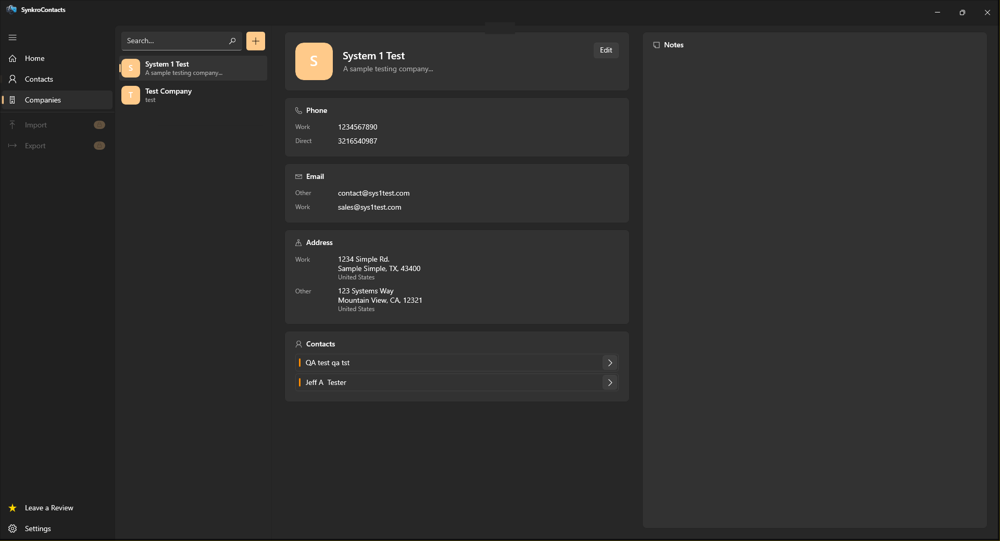
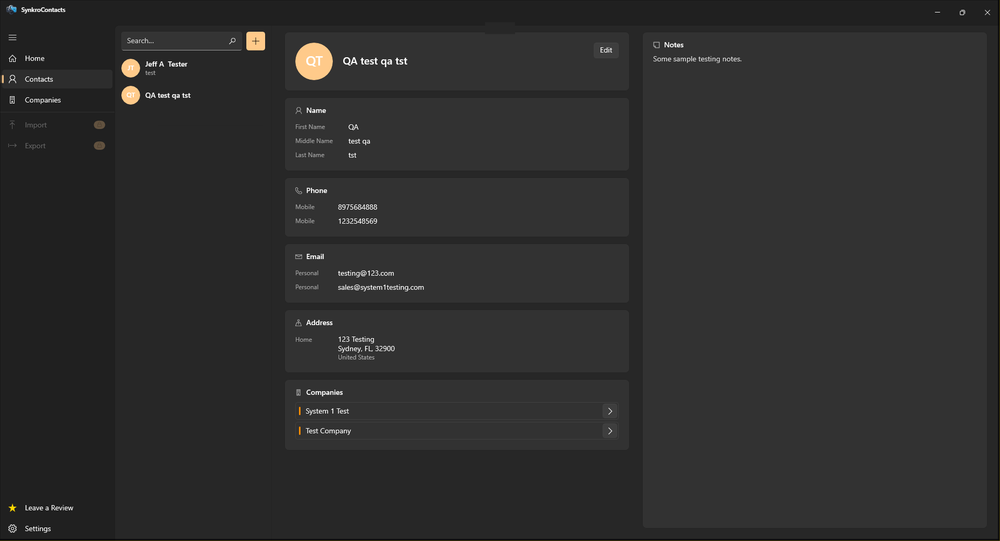
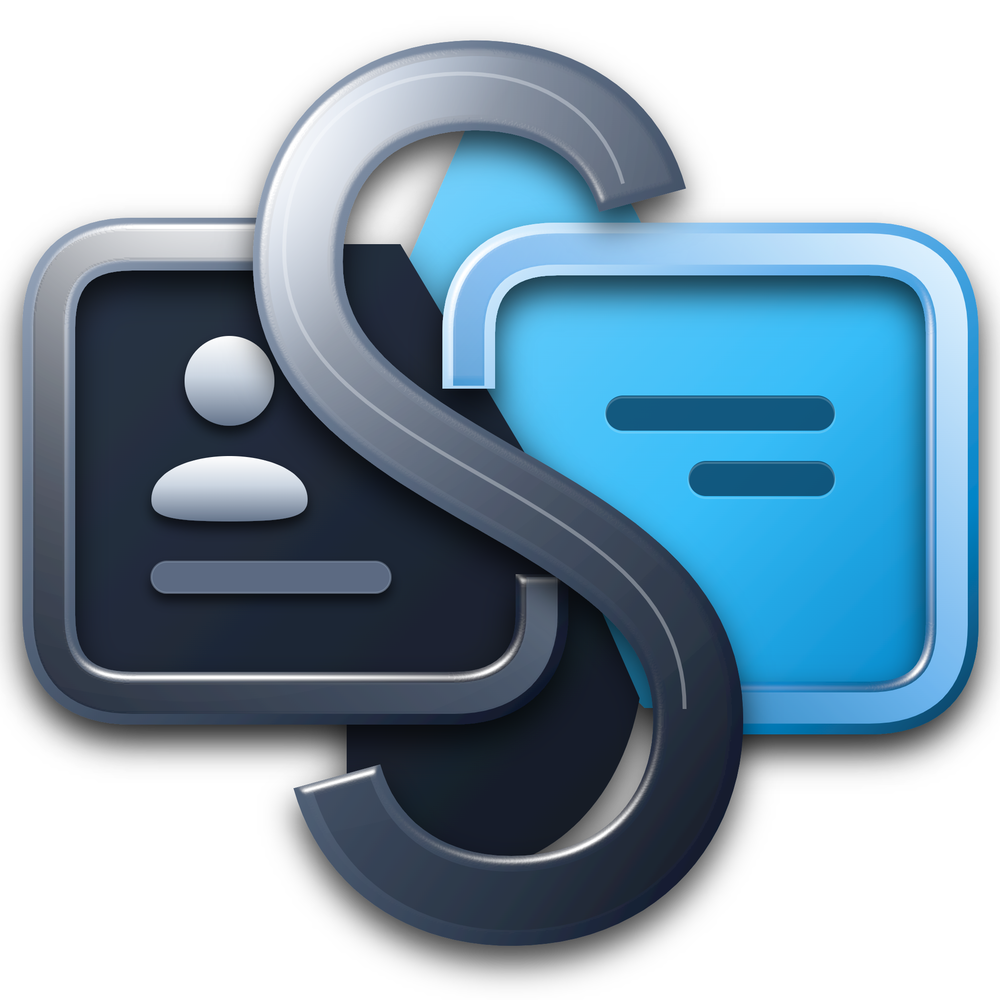

<div align="center">

  

  <br />

  <h1>SynkroContacts</h1>
  <p><b>Native, Local-First Contact & Organization Intelligence for Windows</b></p>

  <p>
    
    
    
    
    
  </p>

  <p>
    <a href="#-interface--workspace">Workspace</a> •
    <a href="#-core-capabilities">Capabilities</a> •
    <a href="#-system-architecture">Architecture</a> •
    <a href="#-development--build">Build</a>
  </p>

</div>

---

**SynkroContacts** is a high-performance Windows desktop relationship manager engineered on **.NET 8**. Designed with a decoupled, multi-layered **MVVM** architecture and local **SQLite** persistence, it delivers a zero-telemetry workspace for managing complex personal and corporate networks.

---

## 🖥️ Interface & Workspace

A distraction-free **3-Pane Master-Detail** layout with real-time filtering, structured entity cards, and contextual notes.

| Cyber Blue Workspace | Amber Gold Workspace |
| :---: | :---: |
|  |  |
|  |  |

---

## ⚡ Core Capabilities

<table>
  <tr>
    <td width="50%" valign="top">
      <b>🕸️ Bidirectional Entity Graph</b><br />
      Many-to-many relational linking between <b>Contacts</b> and <b>Companies</b> with instant cross-entity navigation.
    </td>
    <td width="50%" valign="top">
      <b>🧠 Smart Endpoint Resolution</b><br />
      Multi-channel phones, emails, and addresses with deterministic <code>IsPreferred</code> fallback logic and computed monograms.
    </td>
  </tr>
  <tr>
    <td width="50%" valign="top">
      <b>🔄 High-Fidelity vCard Engine</b><br />
      Standards-compliant <code>.vcf</code> parsing and serialization via <code>FolkerKinzel.VCards</code> for seamless data portability.
    </td>
    <td width="50%" valign="top">
      <b>🔒 Zero-Cloud SQLite Persistence</b><br />
      100% offline-first storage powered by EF Core 8 migrations at <code>%AppData%\SynkroContacts\contacts.db</code>.
    </td>
  </tr>
</table>

---

## 🏗 System Architecture

The solution enforces strict separation of concerns across **5 decoupled projects** targeting `net8.0-windows10.0.19041.0`:

```text
SynkroContacts.sln
├── SynkroContacts/             # Presentation Layer (WinExe, 8 Modular Views, MVVM ViewModels)
├── SynkroContacts.Services/    # Application Layer (Contact/Company Logic, vCard I/O, Logging)
├── SynkroContacts.DataMapping/ # Translation Layer (Bidirectional Entity <-> Domain Mappers)
├── SynkroContacts.Data/        # Persistence Layer (EF Core 8 DbContext, Entities, Migrations)
└── SynkroContacts.Models/      # Domain Layer (Core Entities, Computed Properties, Enums)
```

| Dependency | Version | Responsibility |
| :--- | :---: | :--- |
| `Microsoft.EntityFrameworkCore.Sqlite` | `8.0.11` | Relational data access & automated schema migrations |
| `CommunityToolkit.Mvvm` | `8.3.2` | Source-generated observable properties & relay commands |
| `FolkerKinzel.VCards` | `7.2.1` | RFC-compliant vCard stream serialization & parsing |

---

## 🚀 Development & Build

### Prerequisites
* **OS:** Windows 10 (Build 17763 / v1809+) or Windows 11 (`x64`)
* **Toolchain:** [Visual Studio 2022](https://visualstudio.microsoft.com/) (`.NET desktop development` workload) & [.NET 8.0 SDK](https://dotnet.microsoft.com/download/dotnet/8.0)

### Build from Source
```bash
git clone https://github.com/jackstatham596/SynkroContacts.git
cd SynkroContacts
```
Open **`SynkroContacts.sln`** in Visual Studio 2022, set the active configuration to **`x64`**, and press <kbd>F5</kbd> to compile and initialize the local SQLite database.

---

<div align="center">
  
  <p><sub>Released under the MIT License • Engineered with C# & .NET 8</sub></p>
</div>
